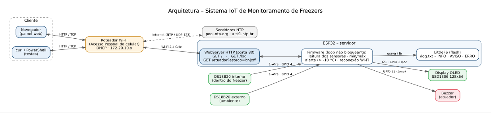
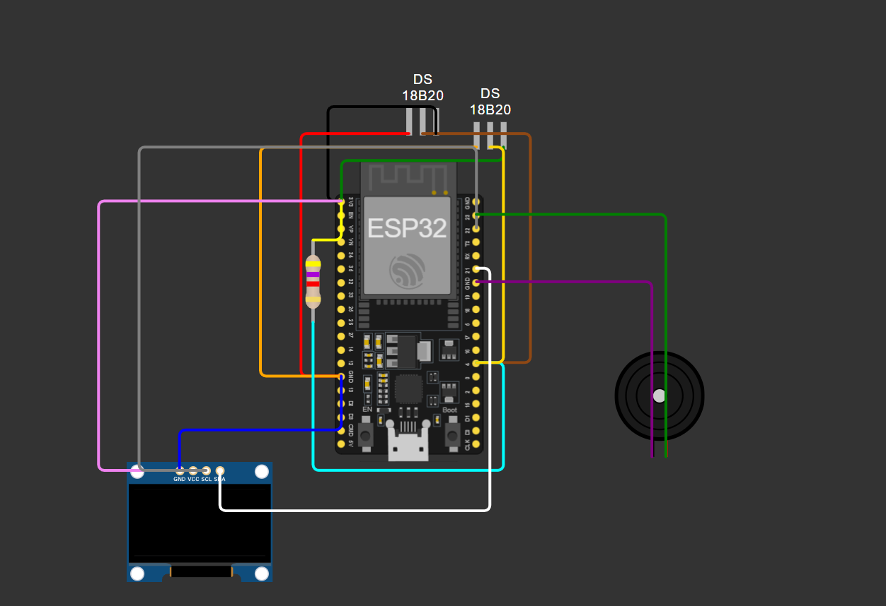
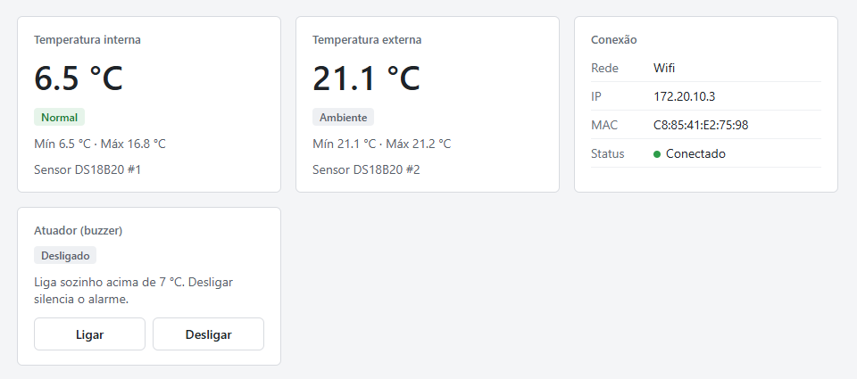
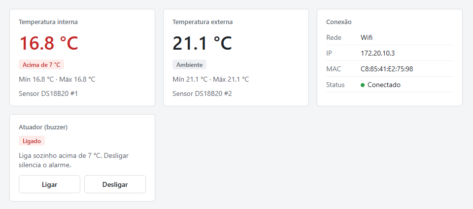
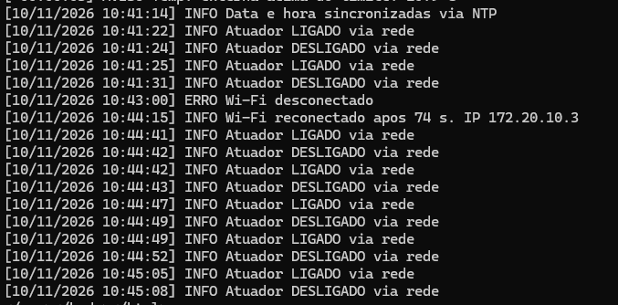
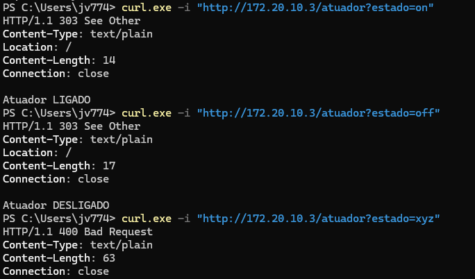
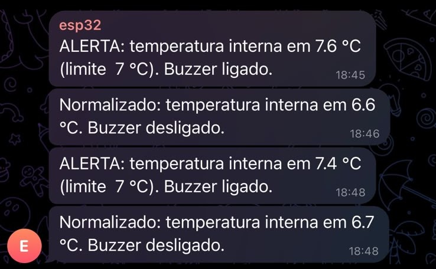

# Sistema IoT de Monitoramento de Freezers

Telemetria térmica contínua de freezers: um ESP32 mede a temperatura interna e externa, mostra os valores em um display OLED e em um painel web, grava um log persistente, emite alertas visuais e sonoros (buzzer) quando a temperatura interna passa do limite e permite controlar o buzzer pela rede, para evitar a perda de insumos.

## Integrantes da Equipe (Grupo 4)

| Nome | RA |
|---|---|
| João Vitor Bidese Rocha | 40131546 |
| Pedro Henrique Borges | 40128171 |
| Pedro Paiva | 40129191 |
| Pietro Maruska | 40128156 |
| Rafael Velasques | 40133421 |

## Funcionalidades

- Leitura não bloqueante de 2 sensores DS18B20 a cada 2 s
- Alerta quando a temperatura interna passa do limite: indicação vermelha no painel, AVISO no log e buzzer ligado automaticamente; o sensor externo mede o ambiente e não usa o limite
- Limite configurável em `LIMITE_TEMPERATURA`: **7 °C** na demonstração (sensor em copo com gelo, ~2 °C); em um freezer real seria -10 °C
- Temperaturas mínima e máxima desde a inicialização
- Detecção de falha de sensor (sensor desconectado aparece como FALHA e é registrado no log)
- Log persistente na flash (LittleFS), com rotação a partir de 16 KB
- Data e hora reais via NTP (horário de Brasília, UTC-3)
- Reconexão automática do Wi-Fi a cada 10 s, sem travar o sistema
- Alerta no Telegram: quando a temperatura passa do limite e quando normaliza, o ESP32 envia uma mensagem por um bot do Telegram (requisição HTTPS à API do Telegram)
- Atuador (buzzer): liga sozinho no alerta e desliga quando a temperatura normaliza; pelo painel é possível ligar manualmente ou silenciar o alarme
- Painel web com atualização automática

## Arquitetura da Solução



O ESP32 funciona como **servidor HTTP** na porta 80. O **cliente** é o navegador (ou o `curl`), na mesma rede Wi-Fi: ele acessa o painel, consulta o log e envia comandos ao atuador. A página é gerada pelo próprio ESP32, por isso não há uma pasta `src/client/` separada. O ESP32 lê os dois DS18B20 pelo barramento 1-Wire, mostra os valores no OLED (I2C), aciona o buzzer (GPIO 23), grava o log na flash (LittleFS) e acerta o relógio pela internet (NTP).

Quando a temperatura interna passa do limite, o ESP32 liga o buzzer e também atua como **cliente HTTP**: faz uma requisição HTTPS à API do Telegram para enviar o alerta ao grupo da equipe. Quando a temperatura normaliza, desliga o buzzer e envia uma nova mensagem.

## Hardware Utilizado

| Componente | Quantidade |
|---|---|
| Microcontrolador ESP32 | 1 |
| Sensor de temperatura DS18B20 (interno e externo) | 2 |
| Display OLED SSD1306 128x64 (I2C) | 1 |
| Buzzer | 1 |
| Resistor 4,7 kΩ (pull-up do barramento OneWire) | 1 |

### Ligações

| Componente | Pino do componente | Pino do ESP32 |
|---|---|---|
| DS18B20 (os dois, em paralelo) | DQ (dados) | GPIO 4 (com pull-up de 4,7 kΩ para 3,3 V) |
| DS18B20 | VDD / GND | 3,3 V / GND |
| OLED SSD1306 (endereço 0x3C) | SDA / SCL | GPIO 21 / GPIO 22 |
| OLED SSD1306 | VCC / GND | 3,3 V / GND |
| Buzzer | + / - | GPIO 23 / GND |

### Esquemático



## Documentação da API / Comunicação

**Protocolo escolhido:** HTTP (servidor web embarcado na porta 80).

**Comunicação de saída:** alertas enviados por HTTPS (porta 443) para `api.telegram.org/bot<TOKEN>/sendMessage`, e sincronização de horário por NTP (UDP, porta 123).

| Rota | Método | Descrição |
|---|---|---|
| `/` | GET | Painel web com temperaturas, rede e atuador (atualiza a cada 2 s) |
| `/log` | GET | Log do sistema gravado na flash (antigo + atual) |
| `/atuador?estado=on` | GET | Liga o buzzer e redireciona para o painel (303) |
| `/atuador?estado=off` | GET | Desliga o buzzer (também silencia o alarme) e redireciona para o painel (303) |

Comando inválido em `/atuador` responde **400** e não altera o estado.

### Testes rápidos com curl

```bash
curl -i http://<IP_DO_ESP32>/
curl http://<IP_DO_ESP32>/log
curl -i "http://<IP_DO_ESP32>/atuador?estado=on"
curl -i "http://<IP_DO_ESP32>/atuador?estado=off"
```

## Instruções de Instalação e Execução

1. Instale a [Arduino IDE](https://www.arduino.cc/en/software) e adicione o suporte ao ESP32 (Gerenciador de Placas → **esp32** da Espressif).
2. Instale as bibliotecas pelo Gerenciador de Bibliotecas:
   - Adafruit SSD1306
   - Adafruit GFX Library
   - OneWire
   - DallasTemperature

   (`WiFi`, `WebServer` e `LittleFS` já vêm com o pacote do ESP32.)
3. Na pasta `src/esp32/esp32_server/`, copie `config.example.h` para `config.h` e preencha o nome e a senha da rede Wi-Fi (o ESP32 só conecta em redes de 2,4 GHz). O `config.h` está no `.gitignore` e não vai para o repositório.
   - **Telegram (opcional):** crie um bot com o @BotFather e preencha `TELEGRAM_TOKEN` no `config.h`. Adicione o bot a um grupo, envie `/start@nome_do_bot` no grupo e abra `https://api.telegram.org/bot<TOKEN>/getUpdates` para obter o `chat.id` (número negativo); preencha `TELEGRAM_CHAT_ID`. Com `SEU_CHAT_ID`, o sistema funciona normalmente, só sem as mensagens.
4. Abra `src/esp32/esp32_server/esp32_server.ino`, selecione a placa **ESP32 Dev Module** e a porta correta, e clique em **Carregar**.
5. Abra o Monitor Serial em **115200** baud. O IP do ESP32 aparece no log e também no display OLED.
6. Acesse `http://<IP_DO_ESP32>/` em um navegador conectado à mesma rede. O navegador é o cliente: não é preciso instalar nada.

### Identificação dos sensores

Ao ligar, o ESP32 guarda o endereço de cada DS18B20: o primeiro encontrado no barramento é o **interno** e o segundo, o **externo**. Essa ordem é definida pelo endereço de fábrica dos sensores e não muda sozinha. Para conferir na montagem, aqueça com a mão o sensor que vai dentro do freezer: deve subir o card **Temp. Interna**.

## Testes

Os testes de ping, porta, HTTP, sensores, atuador, reconexão do Wi-Fi, NTP, estresse e alarme automático com Telegram, com os resultados e os prints, estão em [docs/testes/testes.md](docs/testes/testes.md).

## Screenshots

**Painel web – situação normal:** sensor interno no gelo (6,5 °C, abaixo do limite de 7 °C), sensor externo no ambiente e buzzer desligado:



**Painel web – alerta:** sensor interno fora do gelo (16,8 °C, acima de 7 °C); o buzzer ligou automaticamente:



**Log do sistema** (rota `/log`), com data e hora via NTP, comandos do atuador e a queda e reconexão do Wi-Fi:



**Comandos ao atuador** pela rede (303 para comandos válidos, 400 para inválido):



**Alerta no Telegram:** mensagens enviadas pelo ESP32 ao grupo da equipe quando a temperatura passa do limite e quando normaliza:


