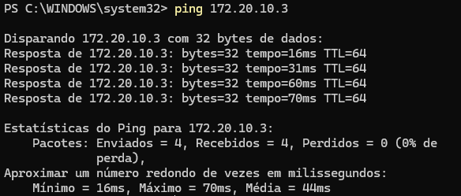
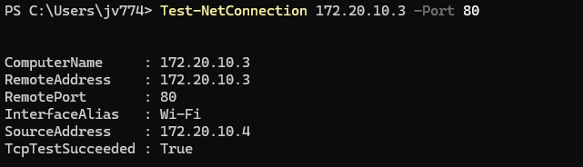
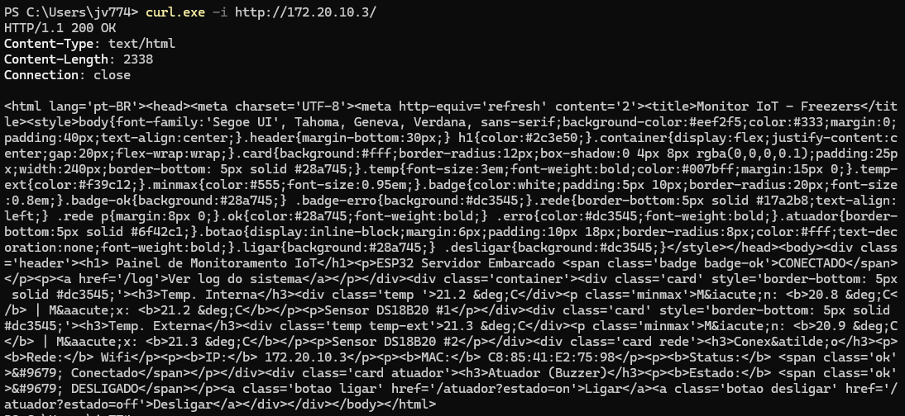
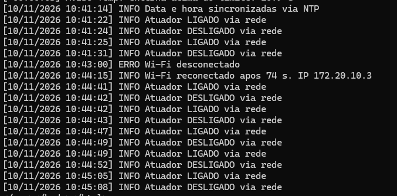
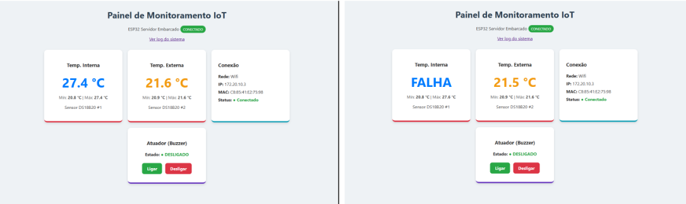
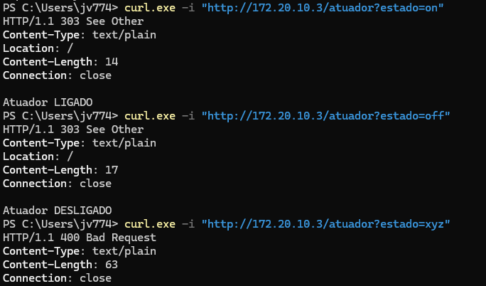
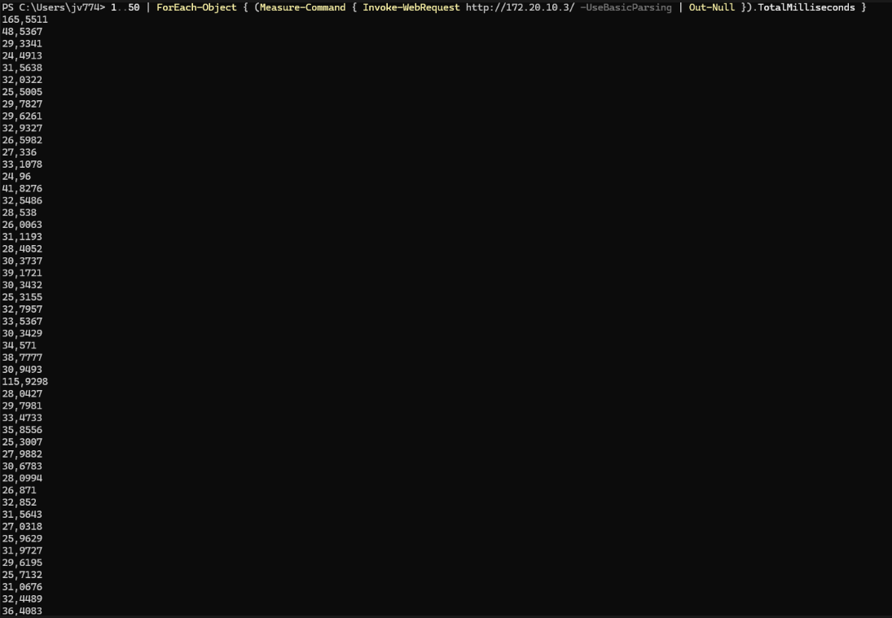

# Testes e Evidências

Testes do Sistema IoT de Monitoramento de Freezers, conforme a seção 6 do enunciado do TDE
(ping, acesso à porta, comunicação cliente-servidor, sensor e atuador via rede) e a Etapa 3 do
regulamento (falha de conexão e estresse).

**Ambiente de teste**

| Item | Valor |
|---|---|
| Placa | ESP32-D0WD-V3 |
| Rede | Roteador do celular (iPhone), SSID `Wifi` |
| IP do ESP32 | `172.20.10.3` (atribuído por DHCP; confirmar no OLED) |
| MAC do ESP32 | `C8:85:41:E2:75:98` |
| Cliente | Notebook conectado à mesma rede, Windows (PowerShell / Prompt de Comando) |

> Os prints de cada teste ficam nesta mesma pasta (`docs/testes/`). Testes realizados em 10/11/2026.

## Resumo

| # | Teste | Camada / requisito | Resultado |
|---|---|---|---|
| 1 | Ping | Rede (ICMP) | ✅ 0% de perda, média 44 ms |
| 2 | Porta 80 | Transporte (TCP) | ✅ TcpTestSucceeded: True |
| 3 | Comunicação HTTP | Aplicação (HTTP) | ✅ 200 OK no painel e no /log |
| 4 | Sensores via rede | Enunciado 6 | ✅ Leitura, mín/máx e falha detectada |
| 5 | Atuador via rede | Enunciado 6 | ✅ 303 (on/off) e 400 (comando inválido) |
| 6 | Queda e reconexão do Wi-Fi | Enunciado 3.2.1 / Etapa 3 | ✅ Reconectou em 74 s |
| 7 | Data e hora via NTP | Enunciado 3.2.1 e 3.2.3 | ✅ Sincronizado |
| 8 | Estresse (50 requisições) | Etapa 3 | ✅ 50/50, média 35,3 ms |

---

## 1. Ping (camada de rede – ICMP)

Verifica se o ESP32 está acessível na rede.

```
ping 172.20.10.3
```

**Esperado:** respostas `Resposta de 172.20.10.3: bytes=32 tempo=...ms TTL=64`, sem perda de pacotes.

**Resultado:** ✅ OK – 4 pacotes enviados, 4 recebidos, 0% de perda. Tempo mínimo 16 ms, máximo 70 ms,
média 44 ms. TTL = 64 (valor padrão da pilha TCP/IP do ESP32).



---

## 2. Acesso à porta 80 (camada de transporte – TCP)

Verifica se o servidor HTTP está escutando na porta 80.

```
Test-NetConnection 172.20.10.3 -Port 80
```

(no Prompt de Comando, com o Telnet habilitado: `telnet 172.20.10.3 80`)

**Esperado:** `TcpTestSucceeded : True` (ou tela do Telnet conectada).

**Resultado:** ✅ OK – `TcpTestSucceeded : True`. O notebook (`172.20.10.4`) abriu uma conexão TCP com o
ESP32 (`172.20.10.3`) na porta 80.



---

## 3. Comunicação cliente-servidor (camada de aplicação – HTTP)

### 3.1 Painel

```
curl.exe -i http://172.20.10.3/
```

**Esperado:** `HTTP/1.1 200 OK` e o HTML do painel com as temperaturas.

### 3.2 Log

```
curl.exe http://172.20.10.3/log
```

**Esperado:** página com as linhas do log (INFO, AVISO, ERRO) com data e hora.

**Resultado:** ✅ OK – o painel respondeu `HTTP/1.1 200 OK`, `Content-Type: text/html`, 2338 bytes,
`Connection: close`, com os dados reais no HTML (interna 21,2 °C, externa 21,3 °C, mín/máx, IP, MAC e
estado do atuador). A rota `/log` devolveu o log com data e hora.





---

## 4. Sensores via rede

1. Abrir `http://172.20.10.3/` no navegador.
2. Segurar um sensor na mão por cerca de 1 minuto.

**Esperado:** a temperatura do card sobe e o **Máx** é atualizado; ao soltar, o Máx continua registrado.

3. Soltar o fio de dados (amarelo) de um sensor e reconectar.

**Esperado:** card mostra **FALHA**; o log registra `ERRO Falha no sensor ...` e depois `INFO Sensor ... OK`.

**Resultado:** ✅ OK – aquecido na mão, o sensor interno subiu de ~21 °C para 27,4 °C e o Máx acompanhou.
Com o fio de dados solto, o card mostrou FALHA e o Mín/Máx foram mantidos (20,8 / 27,6 °C). O log
registrou `ERRO Falha no sensor interno (sem leitura)` às 11:02:48 e `INFO Sensor interno OK` às 11:03:22.




---

## 5. Atuador via rede

```
curl.exe -i "http://172.20.10.3/atuador?estado=on"
curl.exe -i "http://172.20.10.3/atuador?estado=off"
curl.exe -i "http://172.20.10.3/atuador?estado=xyz"
```

**Esperado:**

| Comando | Resposta | Efeito |
|---|---|---|
| `estado=on` | `HTTP/1.1 303 See Other` | Buzzer apita; OLED `Buzzer: ON`; log `INFO Atuador LIGADO via rede` |
| `estado=off` | `HTTP/1.1 303 See Other` | Buzzer para; OLED `Buzzer: OFF`; log `INFO Atuador DESLIGADO via rede` |
| `estado=xyz` | `HTTP/1.1 400 Bad Request` | Nada muda; log `AVISO Comando invalido em /atuador` |

**Resultado:** ✅ OK – `on` e `off` responderam `303 See Other` com `Location: /` e os textos
"Atuador LIGADO" / "Atuador DESLIGADO"; o buzzer apitou e parou. `xyz` respondeu `400 Bad Request`
sem alterar o atuador. Os comandos aparecem no log com data e hora.



---

## 6. Falha de conexão e reconexão do Wi-Fi

1. Com o sistema funcionando, desligar o roteador do celular (Acesso Pessoal).
2. Observar o OLED: `Wi-Fi: OFF`. Sensores e display continuam funcionando.
3. Esperar cerca de 30 segundos e religar o roteador.
4. Abrir `http://172.20.10.3/log`.

**Esperado no log:**

```
[dd/mm/aaaa hh:mm:ss] ERRO Wi-Fi desconectado
[dd/mm/aaaa hh:mm:ss] INFO Wi-Fi reconectado apos NN s. IP 172.20.10.3
```

**Resultado:** ✅ OK – a conexão caiu às 10:43:00 (`ERRO Wi-Fi desconectado`) e voltou sozinha às 10:44:15
(`INFO Wi-Fi reconectado apos 74 s. IP 172.20.10.3`), sem reiniciar o ESP32 e com o mesmo IP.


---

## 7. Data e hora via NTP

Com o roteador com acesso à internet, reiniciar o ESP32 (botão EN) e abrir `/log`.

**Esperado:** as primeiras linhas aparecem com `+00:00:0x` (antes do relógio ser acertado), seguidas de
`INFO Data e hora sincronizadas via NTP`; a partir daí as linhas aparecem com data e hora reais.

**Resultado:** ✅ OK – `[10/11/2026 10:41:14] INFO Data e hora sincronizadas via NTP`; todas as linhas
seguintes aparecem com data e hora de Brasília.


---

## 8. Teste de estresse

Envia 50 requisições seguidas ao painel e mede o tempo de cada uma (PowerShell):

```
1..50 | ForEach-Object { (Measure-Command { Invoke-WebRequest http://172.20.10.3/ -UseBasicParsing | Out-Null }).TotalMilliseconds }
```

**Esperado:** todas as requisições respondidas, sem travamento ou reinício do ESP32 (conferir no Monitor
Serial que não aparece `rst:` no meio do teste).

**Resultado:** ✅ OK – 50 de 50 requisições respondidas, sem erros e sem reinício do ESP32.

| Medida | Valor |
|---|---|
| Tempo médio | 35,3 ms |
| Mediana | 30,5 ms |
| Mínimo | 24,5 ms |
| Máximo | 165,6 ms (1ª requisição, que inclui a preparação da conexão) |
| Tempo total | ~1,8 s |


